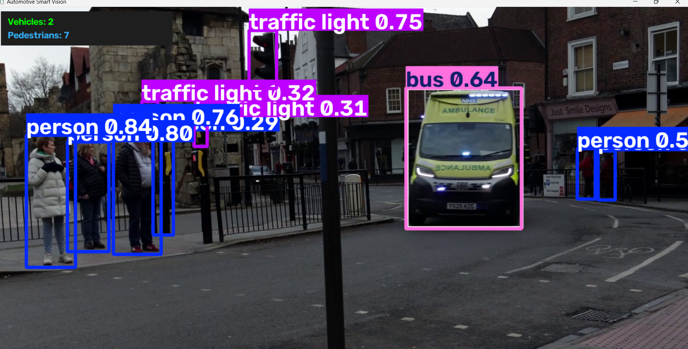
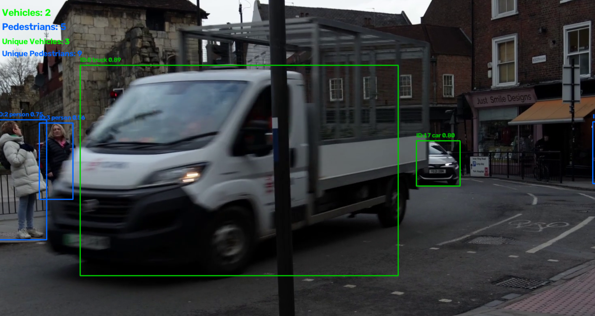
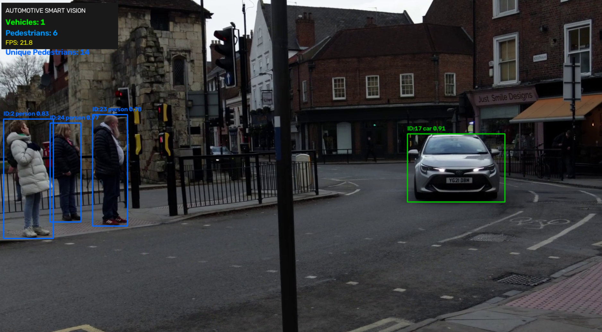

# Automotive Smart Vision – AI-Based Vehicle and Pedestrian Detection & Tracking

## 1. Project Overview

Automotive Smart Vision is a software-based automotive computer vision demonstrator designed to detect and track vehicles and pedestrians in road traffic videos.

The system uses a pretrained YOLOv8 model for object detection, ByteTrack for multi-object tracking, and OpenCV for video processing and visualisation.

The application displays bounding boxes, object classes, tracking IDs, detection confidence, object counts and processing FPS.

The project is developed using software tools without requiring physical automotive hardware.

## 2. Project Objectives

- Develop an AI-based vehicle and pedestrian detection system.
- Process recorded road-scene videos using OpenCV.
- Integrate a pretrained YOLOv8 object detection model.
- Implement multi-object tracking using ByteTrack.
- Display persistent tracking IDs for detected objects.
- Calculate vehicle and pedestrian counts.
- Measure video processing performance using FPS.
- Evaluate system behaviour through software testing.

## 3. System Architecture

```text
Road Traffic Video
        |
        v
OpenCV Video Processing
        |
        v
YOLOv8 Object Detection
        |
        v
ByteTrack Multi-Object Tracking
        |
        v
Detection and Tracking Data
        |
        v
Visualisation and Information Panel
        |
        v
Vehicle/Pedestrian Counts and FPS
```

## 4. Technologies and Tools

| Technology | Application |
|---|---|
| Python | Main development language |
| OpenCV | Video processing and visualisation |
| YOLOv8n | Vehicle and pedestrian detection |
| ByteTrack | Multi-object tracking |
| NumPy | Numerical processing |
| Git and GitHub | Version control |
| VS Code | Development environment |

## 5. Implemented Modules

- Video Processing
- AI Object Detection
- Multi-Object Tracking
- Vehicle and Pedestrian Counting
- FPS Performance Monitoring
- Detection Visualisation

## 6. Performance and Testing

The system was tested using a recorded road traffic video.

| Parameter | Observed result |
|---|---|
| Object detection | Working |
| Vehicle tracking | Working |
| Pedestrian tracking | Working |
| Tracking ID consistency | Verified for a tested vehicle sequence |
| FPS | Approximately 29 FPS observed peak |

Performance depends on the computer hardware, video resolution and traffic scene.

## 7. Project Limitations

- Uses a pretrained YOLOv8n model.
- Detection performance depends on lighting, visibility and object size.
- Tracking IDs may change when objects are occluded or lost.
- The system has not been validated for safety-critical automotive deployment.

## 8. Project Type

Software-only automotive computer vision demonstrator.

No physical automotive hardware is required.


## 9. Project Demonstration

### Vehicle and Pedestrian Detection



### Multi-Object Tracking



### Performance Monitoring

